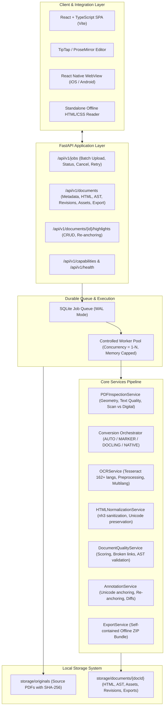

# Multilingual PDF to HTML Conversion Platform - Architecture Document

## 1. System Overview & Architectural Principles

The **Multilingual PDF to HTML Conversion Platform** is designed as a local-first, production-ready system for converting multi-page, complex, multilingual PDF documents into clean, semantic, editable, selectable, and annotatable HTML. 

### Core Architectural Principles
1. **Semantic HTML over Pixel-Perfect Simulation**: Documents are parsed into real DOM text nodes (`<p>`, `<h1>`–`<h6>`, `<table>`, `<ul>`, `<ol>`, `<figure>`, `<blockquote>`, `<code>`, `<math>`). Canvas rendering, SVG text glyphs, and full-page screenshots are strictly prohibited as primary representations.
2. **True DOM Selectability & Editability**: Every text node is standard selectable text. This enables native browser copying, full-text searching, screen readers (a11y), responsive reflow across device form factors, and integration with rich-text editors (TipTap/ProseMirror).
3. **Canonical Intermediate Representation (AST)**: Documents are converted first into a versioned, lossless JSON Canonical Document Model with stable block identifiers (`blk-<page>-<seq>-<hash>`) before rendering to semantic HTML.
4. **Durable, Multilingual Highlighting**: Text annotations are anchored using dual mechanisms: **Text Quote Anchoring** (`exact`, `prefix`, `suffix`) and **Unicode Code Point Position Anchoring** (`start`, `end` in codepoints, handling UTF-16 vs Unicode code points vs grapheme clusters). Highlights render via the modern **CSS Custom Highlight API** with a fallback to non-destructive DOM `<mark>` wrapping.
5. **Durable Local-First Processing**: Designed for a resource envelope of 16 GB RAM and 4 GB VRAM (RTX 3050 Ti) or CPU-only operation. A durable SQLite job queue handles concurrency control, recovery from unexpected terminations, and status tracking.
6. **Zero External Cloud Dependencies**: No paid APIs, no hosted LLMs, no remote font CDNs. Operates 100% offline.

---

## 2. High-Level Architecture



---

## 3. PDF Inspection Engine (`PDFInspectionService`)

Before committing heavy OCR or converter resources, every document undergoes a non-destructive inspection using PyMuPDF and `pdfplumber`.

### Page Classification State Machine
Pages are classified into five distinct operational states:
1. `DIGITAL_TEXT`: Embedded searchable text layer with high font-to-glyph consistency and unicode validity.
2. `SCANNED_IMAGE`: No font or vector text detected; contains high-resolution bitmap raster(s) covering >85% of page area.
3. `MIXED_CONTENT`: Vector/digital text present alongside raster diagrams, equations, or scanned margin notes.
4. `TEXT_ENCODING_PROBLEM`: Embedded text present, but exhibits high replacement character ratio (`\ufffd`), suspicious mojibake glyph sequences, or private use area (PUA) codes indicating broken ToUnicode CMaps.
5. `UNKNOWN`: Empty pages, corrupt page dictionaries, or unrenderable vector trees.

### Text Quality Metrics
The inspection engine analyzes:
- **Unicode Validity**: Detects unmapped glyphs, replacement character frequency, and control character density.
- **Glyph Bounding Box Density**: Evaluates text density relative to page geometry.
- **Character Repetition Rate**: Identifies corrupt font descriptors emitting repeating sequences (e.g., `ffffffff`).
- **Language Heuristics**: Character set distribution across Latin, Devanagari, Tamil, Arabic, Han, Hangul, etc.

---

## 4. Converter Abstraction & Pipeline

All converters implement the abstract base interface `PDFConverter`:

```python
class PDFConverter(ABC):
    @abstractmethod
    def convert(self, source_path: Path, options: ConversionOptions) -> CanonicalDocument:
        pass

    @abstractmethod
    def check_availability(self) -> bool:
        pass

    @abstractmethod
    def get_capabilities(self) -> ConverterCapabilities:
        pass
```

### Conversion Strategies
- **Primary: Marker (`MarkerConverter`)**: Leverages Surya layout and detection models to extract multi-column academic and textbook formatting into structured Markdown/HTML.
- **Secondary / Fallback: Docling (`DoclingConverter`)**: Leverages IBM Docling parser to extract rich document structure, complex nested tables, and inline equations.
- **High-Precision Native / OCR Pipeline (`NativeHybridConverter`)**: A zero-cloud fallback built on PyMuPDF block extraction, Tesseract OCR for image regions, layout reading order sorting, table boundary detection, and image asset extraction.
- **Conversion Orchestration (`ConversionOrchestrator`)**:
  - In `AUTO` mode: If page inspection reveals `SCANNED_IMAGE` or `TEXT_ENCODING_PROBLEM`, it activates OCR preprocessing with appropriate language packs. If Marker or Docling are present and document meets complexity criteria, it invokes them with lazy weight loading. If GPU/VRAM is unavailable, it uses CPU mode with safe batching.

---

## 5. Multilingual OCR Engine (`OCRService`)

Tesseract 5.x serves as the underlying OCR engine, accessed via `pytesseract`.

### Key Features
1. **Dynamic Multi-Language Packs**: Supports comma-separated or plus-separated language definitions (e.g., `eng+tam`, `hin+eng`, `ara+eng`).
2. **Capability Introspection**: Queries `/opt/homebrew/share/tessdata` (or OS tessdata directory) to report available language packs to the API.
3. **Image Preprocessing**:
   - Contrast Limited Adaptive Histogram Equalization (CLAHE) for low-contrast scans.
   - Otsu binarization for clean document text segmentation.
   - Automatic deskewing via projection profile analysis.
4. **Script Directionality**: Explicitly tags Arabic, Urdu, Hebrew, and Farsi blocks with `dir="rtl"` and appropriate ISO 639-1/639-3 `lang` codes.
5. **Indic Script Preservation**: Avoids normalization passes that strip virama, vowel signs (matras), or zero-width joiners (`ZWJ`, `ZWNJ`).

---

## 6. Canonical Document Model (AST)

The Canonical Document Model serves as the single source of truth between converters, the HTML generator, and the TipTap editor.

### Schema Definition
- `documentId`: UUIDv4
- `sourceFileName`: Original filename
- `sourceChecksum`: SHA-256 hex digest
- `title`: Extracted or fallback title
- `language`: Primary document language (BCP-47)
- `revision`: Integer monotonic version counter
- `pages`: List of `PageMetadata` (dimensions, orientation, scan classification)
- `blocks`: Ordered list of `DocumentBlock`
- `assets`: Mapping of asset ID to asset metadata (path, mime-type, dimensions)
- `warnings`: Structural warnings and diagnostics

### Block Specification
Each `DocumentBlock` contains:
- `blockId`: Stable deterministic identifier (e.g., `blk-p01-b003-a8f1`)
- `blockType`: `heading` | `paragraph` | `list` | `listItem` | `table` | `image` | `caption` | `blockquote` | `equation` | `code` | `pageBreak`
- `sourcePage`: 1-based page number
- `language`: Block-specific language override
- `direction`: `"ltr"` | `"rtl"` | `"auto"`
- `content`: Plain or annotated text content
- `inlineFormatting`: List of inline style spans (`strong`, `em`, `code`, `link`, `sub`, `sup`)
- `readingOrder`: 0-based logical reading order index
- `provenance`: `{"engine": "marker"|"docling"|"ocr"|"native", "confidence": float, "page": int}`
- `metadata`: Table cell structure, image dimensions, heading levels (1–6)

---

## 7. Semantic HTML Generation & Normalization

### Semantic Tag Mapping
- Headings: `<h1>` through `<h6>` with `id="heading-X"` and `data-block-id="blk-..."`
- Paragraphs: `<p>` with `data-block-id="blk-..."`
- Tables: Full table structure (`<table>`, `<thead>`, `<tbody>`, `<tr>`, `<th>`, `<td>`) with `colspan` and `rowspan`
- Figures: `<figure>` containing `` and `<figcaption>`
- Math: `<math>` or LaTeX wrapped in `<span class="equation" data-math="...">`
- Reading flow: Enclosed in `<article>` and `<section data-page="N">`

### Normalization & Security Rules
- **Sanitization via `nh3`**: Strips `<script>`, `<iframe>`, `onload`, and javascript pseudo-protocols. Preserves `data-block-id`, `data-page`, `lang`, `dir`, and semantic markup.
- **Asset Relativization**: All images reference `./assets/<filename>`, ensuring complete offline independence.
- **Typography & Font Bundling**: System font stacks prioritized for Unicode (Noto Sans, Devanagari, Tamil Sangam MN, Arial Unicode MS) without requiring remote Google Fonts.

---

## 8. Persistent Text Selection & Highlighting Engine

### Dual Anchoring Architecture
To survive DOM re-renderings, font-size changes, and minor content edits, highlights use **dual anchoring**:
1. **Text Quote Anchoring** (W3C Web Annotation Data Model):
   - `exact`: The exact selected text.
   - `prefix`: 32 characters preceding the selection.
   - `suffix`: 32 characters following the selection.
2. **Text Position Anchoring**:
   - `start`: Unicode codepoint offset from start of block.
   - `end`: Unicode codepoint offset from start of block.
   - `unit`: `"unicode-codepoint"` (distinguished from JavaScript UTF-16 code units).

### Rendering Engine: CSS Custom Highlight API + Mark Fallback
- **Primary Rendering**: Uses `CSS.highlights.set(highlightId, new Highlight(range))`. This achieves 60fps performance and zero DOM tree mutations, avoiding editor corruption and selection glitches.
- **Fallback Rendering**: In environments lacking `CSS.highlights` (older WebViews), wraps the selected Range in `<mark class="doc-highlight" data-highlight-id="...">`.
- **Re-anchoring Algorithm**: When document revisions change text, a fuzzy search over `prefix + exact + suffix` with Levenshtein tolerance relocates the span or marks it as `UNRESOLVED` without misplacing the annotation.

---

## 9. React Native WebView Bridge

The reader communicates bidirectionally with the host React Native application via `window.ReactNativeWebView.postMessage`:

### Bridge Message Types
| Direction | Event Name | Payload Summary |
|-----------|------------|-----------------|
| Reader → Native | `READER_READY` | Document ID, page count, initial highlight count |
| Reader → Native | `TEXT_SELECTED` | Block IDs, selected text, quote anchors, position |
| Reader → Native | `HIGHLIGHT_CREATED` | Serialized `HighlightAnnotation` |
| Reader → Native | `HIGHLIGHT_REMOVED` | `highlightId` |
| Reader → Native | `READER_ERROR` | Error code and descriptive message |
| Native → Reader | `INIT_DOCUMENT` | HTML content, initial highlights, theme |
| Native → Reader | `SET_FONT_SIZE` | Relative scale factor (`0.8` to `2.0`) |
| Native → Reader | `SET_THEME` | `"light"` \| `"dark"` \| `"sepia"` |
| Native → Reader | `APPLY_HIGHLIGHT` | Remote highlight addition |
| Native → Reader | `SEARCH_QUERY` | Find in page query |

---

## 10. Durable SQLite Job Queue & Concurrency Management

- **Queue Table**: Stores job ID, document ID, file path, converter choice, OCR languages, state, progress (0–100%), error message, and timestamps.
- **Concurrency Control**: A single worker thread runs by default (`MAX_CONCURRENT_WORKERS = 1`), preventing OOM crashes on 16 GB RAM systems when heavy models run.
- **Crash Recovery**: On application boot, any jobs in `INSPECTING`, `CONVERTING`, or `OCR_PROCESSING` are reset to `QUEUED` or marked `FAILED` with retry eligibility.
- **Graceful Cancellation**: Workers check `job.is_cancelled` before each major pipeline phase and clean up scratch buffers.
