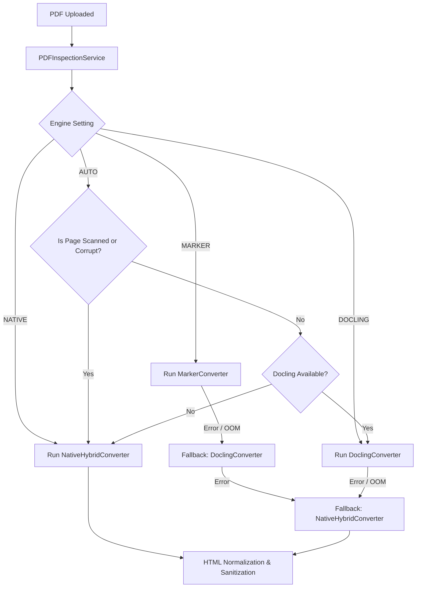

# PDF Conversion Engine Specification

## 1. Converter Abstraction

All converters inherit from the abstract base class `PDFConverter`:

```python
class PDFConverter(ABC):
    @abstractmethod
    def convert(self, source_path: Path, options: ConversionOptions) -> CanonicalDocument:
        """Parse source PDF and return the Canonical Document Model AST."""
        pass

    @abstractmethod
    def check_availability(self) -> bool:
        """Verify underlying libraries, weights, or binaries are installed."""
        pass

    @abstractmethod
    def get_capabilities(self) -> ConverterCapabilities:
        """Return engine metadata and hardware requirements."""
        pass
```

---

## 2. Converter Implementations

### A. Primary Engine: Marker (`MarkerConverter`)
- **Underlying Technology**: Uses VikParuchuri's Marker v2 with Surya layout detection and OCR models.
- **Strengths**: Excels at complex academic multi-column papers, mathematical equations, and inline footnotes.
- **Memory Management**: Implements lazy model initialization (`_load_models()`) and explicit VRAM/RAM cleanup (`unload_models()`) via `marker.models.shutdown_models()`. Avoids keeping weights permanently resident in memory when idle.

### B. Secondary Engine: Docling (`DoclingConverter`)
- **Underlying Technology**: IBM Docling v2.147+ parser (`docling.document_converter.DocumentConverter`).
- **Strengths**: State-of-the-art table structure extraction, nested table headers, and cross-cell spans.
- **Workflow**: Invokes Docling's converter, extracts the element tree, parses structured HTML and tables into `CanonicalDocument` blocks with deterministic IDs.

### C. Native Hybrid Engine (`NativeHybridConverter`)
- **Underlying Technology**: Direct PyMuPDF (`fitz`) geometry parser, embedded raster extraction, `page.find_tables()`, and Tesseract OCR.
- **Strengths**: Zero model weights to download, runs at 20–50 pages/second on CPU, ultra-low memory footprint (<100 MB RAM), 100% offline.
- **OCR Integration**: Automatically activates 300 DPI page rasterization and Tesseract OCR when pages are detected as `SCANNED_IMAGE` or when `force_ocr=True`.
- **Bidirectional Ordering**: Automatically applies `python-bidi` and `arabic-reshaper` to visual-order Arabic/Hebrew PDF streams, reconstructing true logical reading order.

---

## 3. Orchestration & Fallback Strategy

The `ConversionOrchestrator` governs engine selection:



### Safety Guarantees
- No document conversion ever fails silently.
- If an advanced neural engine runs out of memory (e.g. on 4 GB VRAM systems), the pipeline logs a `CONVERTER_FALLBACK` warning and executes the Native Hybrid converter to completion.

