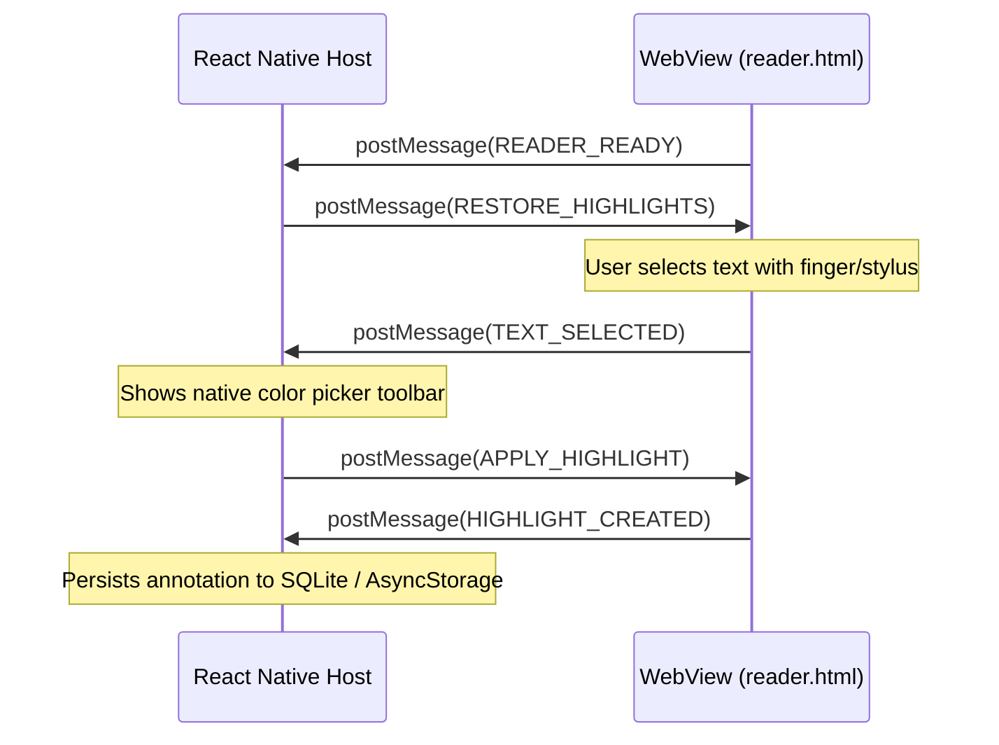

# React Native WebView Integration Guide

## 1. Overview & Offline Architecture

The generated semantic HTML and reader script are designed to operate completely offline inside `react-native-webview` across iOS (WKWebView) and Android (Android System WebView).

Zero internet connection is required:
- All styles are inlined in `reader.css`.
- All images are referenced via relative paths (`./assets/img_p1_0.png`).
- Standard system fonts are utilized for Unicode rendering (Noto Sans, Tamil Sangam MN, Devanagari Sangam MN, Geeza Pro).

---

## 2. JavaScript Bridge Protocol

Communication is bidirectional using JSON payloads conforming to `BRIDGE_PROTOCOL_VERSION = 1`.



---

## 3. Bridge Message Specifications

### A. Messages Emitted by Reader (`Reader → Native`)

#### 1. `READER_READY`
Sent when the DOM has finished loading and reader scripts are initialized.
```json
{
  "version": 1,
  "type": "READER_READY",
  "payload": {
    "documentId": "4c9470d0-fb16-46b0-96f7-4638a143f550",
    "pageCount": 4,
    "activeHighlightsCount": 0,
    "supportsCustomHighlightApi": true
  }
}
```

#### 2. `TEXT_SELECTED`
Sent when a user highlights a word, sentence, or multi-paragraph passage.
```json
{
  "version": 1,
  "type": "TEXT_SELECTED",
  "payload": {
    "documentId": "4c9470d0-fb16-46b0-96f7-4638a143f550",
    "blockIds": ["blk-p1-s002-c9d2"],
    "selectedText": "தமிழ் ஒரு அழகான மொழி",
    "quote": {
      "exact": "தமிழ் ஒரு அழகான மொழி",
      "prefix": "அறிமுகம்: ",
      "suffix": ". இது செம்மொழியாகும்."
    },
    "position": {
      "start": 10,
      "end": 31,
      "unit": "unicode-codepoint"
    },
    "rect": {
      "x": 45.0,
      "y": 182.5,
      "width": 210.0,
      "height": 22.0
    }
  }
}
```

#### 3. `LINK_CLICKED`
Sent when a user clicks a hyperlink inside the document, allowing the native app to prompt confirmation or launch the system browser.
```json
{
  "version": 1,
  "type": "LINK_CLICKED",
  "payload": {
    "href": "https://example.com/research",
    "text": "Reference paper"
  }
}
```

---

## 4. Messages Received by Reader (`Native → Reader`)

The native application communicates with the reader using `webViewRef.current.postMessage(JSON.stringify(msg))`.

| Message Type | Payload Parameters | Action |
|--------------|-------------------|--------|
| `SET_FONT_SIZE` | `{ scale: 1.2 }` | Scales typography between `0.8` (small) and `2.0` (extra large) |
| `SET_THEME` | `{ theme: "light" \| "dark" \| "sepia" }` | Updates colors and reader background |
| `APPLY_HIGHLIGHT` | `HighlightPayload` | Applies high-speed CSS highlight to current selection |
| `REMOVE_HIGHLIGHT` | `{ id: "hl-123" }` | Clears highlight from active highlights map |
| `RESTORE_HIGHLIGHTS` | `{ highlights: [...] }` | Reconstructs and paints all saved annotations |

---

## 5. React Native Implementation Example

A production-ready integration component is provided at:
`reader/examples/ReactNativeWebViewExample.tsx`

To use in your project:
```bash
npm install react-native-webview
```
Then import and render:
```tsx
import { MultilingualDocReader } from './reader/examples/ReactNativeWebViewExample';

export default function App() {
  return (
    <MultilingualDocReader
      documentId="4c9470d0-fb16-46b0-96f7-4638a143f550"
      documentHtml={offlineDocumentHtml}
      initialHighlights={savedHighlightsList}
    />
  );
}
```

